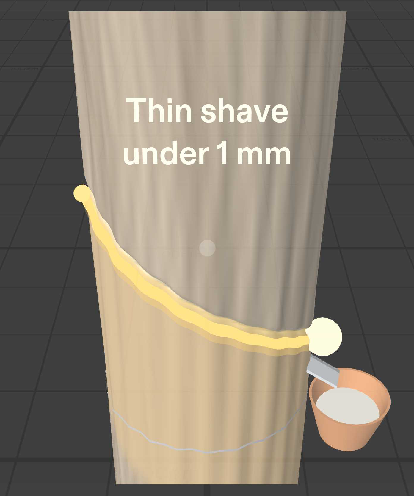
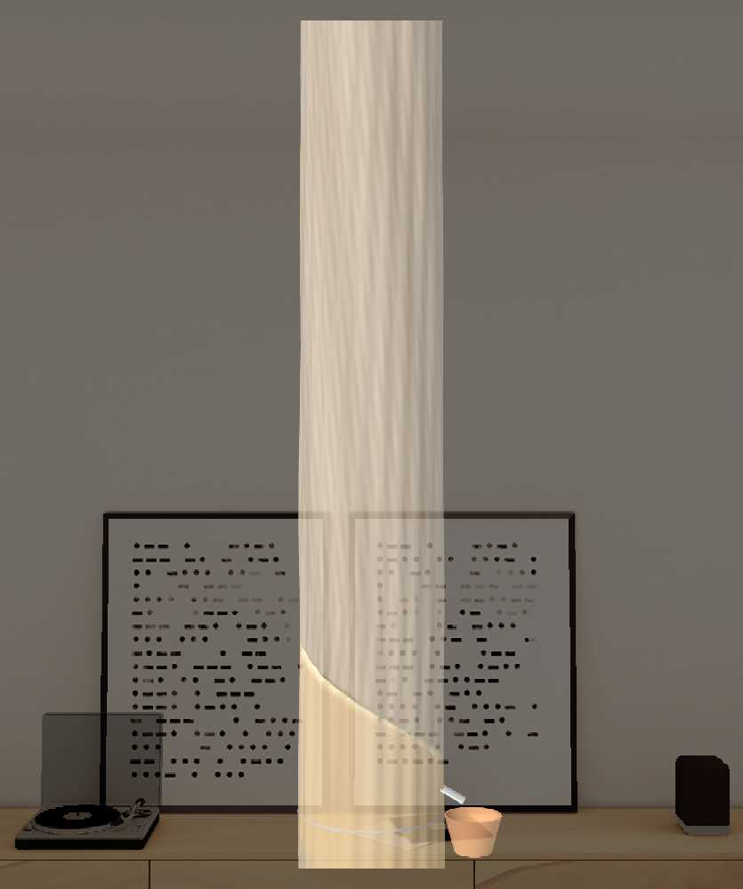
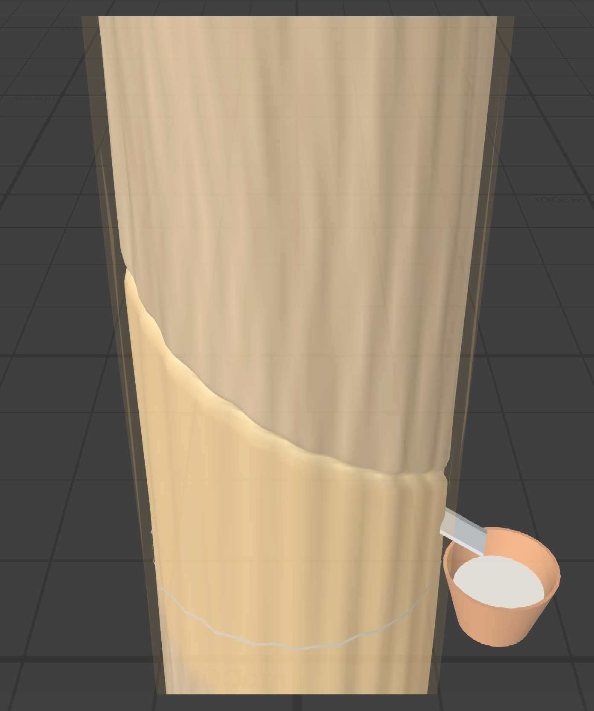
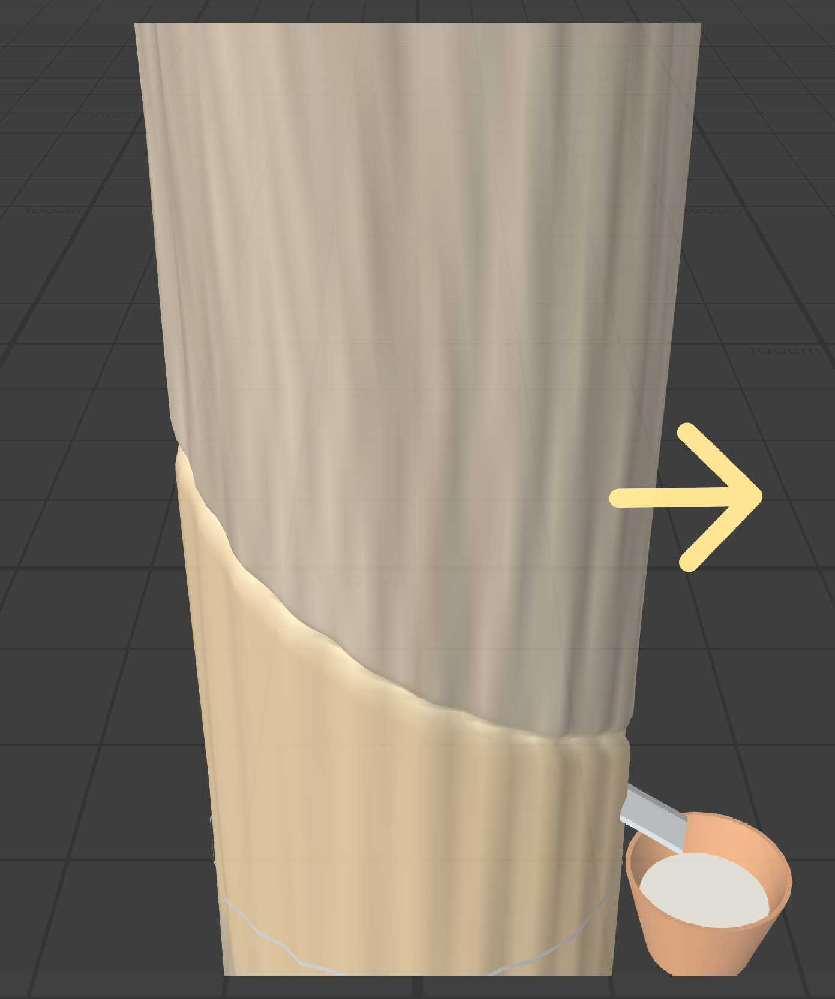
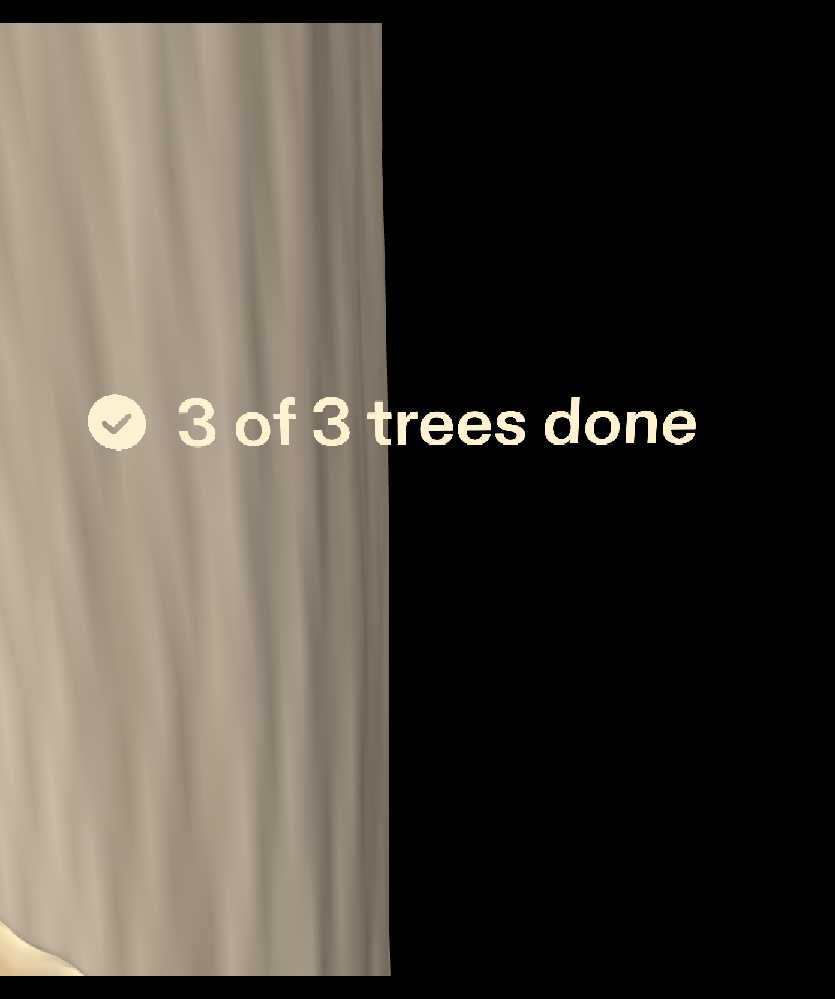

# TapLine

**A pre-dawn rubber-tapping guide for Snap SPECS.** TapLine draws the correct tapping cut on the trunk itself, gives one short tip for that tree, then gets out of the way. When you finish the cut, a soft "tok" from the next tree tells you where to walk.

Built for Devpost's **Learn AR with SPECS** (Oct 15 – Nov 9, 2026). Planned with the Devpost Learn `plan-lens` skill, built by Snap's CLAD agents in Lens Studio 5.23.2 through the Lens Studio MCP, and tested with LEAF. It runs in Lens Studio's preview; no glasses are needed.

**Demo video:** _link added after upload_

## Who it's for

New and returning rubber tappers in Malaysia. I'm from Bentong, Pahang, where rubber smallholdings are everywhere.

- The sector is short of roughly **70–80 thousand tappers**, and about **420,000 ha** of smallholdings sit untapped ([The Star, 4 Jan 2024](https://www.thestar.com.my/news/nation/2024/01/04/rubber-sector-needs-80000-workers-says-johari)). Many people are learning now.
- Tapping happens **before dawn, in the dark**, with a knife in one hand. Latex flow is best roughly 02:00–06:00 ([Kerala Agricultural University](https://celkau.in/crops/cashcrops/rubber/harvesting.php)).
- A cut that is **too deep** (it should stay under 1 mm from the cambium) or at the **wrong slope** (about 30° on budded trees, high left to low right) wounds the bark and its yield for years (KAU; [Rubber Research Institute of Sri Lanka](https://www.rrisl.gov.lk/content/files/downDoc/11.%20Tapping%20&%20Use%20of%20Rainguards.pdf)).

A phone or a paper chart can't help at the tree: both hands are busy and your eyes need to stay on the bark.

## What it does: one spatial moment

You walk up to a tree and stop at arm's length. One pinch on the trunk, and a thin glowing line appears exactly where the knife should go. It starts about 120 cm up on the left and slopes down to the right at about 30°, just below the old cut. A two-line tip for that tree shows for four seconds and fades. You tap along the line, pinch the end mark, and the guide fades. A spatial "tok" plays from the next tree. If that tree is out of view, a yellow arrow at the edge of your view points to it until you face it. After the third tree, "3 of 3 trees done" appears and fades.

| | |
|---|---|
|  |  |
|  |  |

### Why it belongs on glasses

- **Draws in the world:** the guide sits on the bark at real size, not on a screen.
- **Leaves your body free:** one pinch to start, one pinch when you're done. The knife never leaves your hand.
- **Eyes up, sound-led:** the next tree is found by a spatial sound and an edge arrow, not by looking down at a map.

### Design decisions (from the brief)

- **One big target per step:** the whole trunk to start, and a 5 cm end mark placed where the knife naturally finishes, away from the start, so it can't be hit by accident while tapping.
- **Show, then recede:** the trunk glows only within 1.5 m; the tip fades after about 4 s; the guide fades when you're done; there is no counter while tapping.
- **Information on the thing it's about:** each tree has its own tip, e.g. "Cut too deep last time / go shallower".
- **Additive display:** warm white and yellow light only, with no dark UI (black renders as transparent on SPECS).
- **Stand-ins (the preview can't recognise real things):** three virtual rubber trees, each with an old cut already on the bark, laid out about 3 m apart (Tree 2 to your right, Tree 3 behind you). Pinching the trunk stands in for recognising the tree, and the per-tree tips are hard-coded.

The full brief is in [`devpost/design-brief.md`](devpost/design-brief.md).

## Done criteria and LEAF results

Each done criterion has its own LEAF scenario in `Assets/Tests/`. **All five pass** in Lens Studio's preview.

| # | Done criterion | LEAF scenario | Measured |
|---|---|---|---|
| 1 | Trunk glows within ~1.5 m, off when you walk away | `c1-proximity-glow` | on at 149 cm, off at 150.5 cm |
| 2 | Pinching the trunk shows the guide, both marks and the tip | `c2-cut-guide` | line 120 → 99 cm at 29–30°, 2 cm start mark, 5 cm end mark |
| 3 | Tip fades after ~4 s, line stays | `c3-tip-note-fade` | fade starts 3.9 s, gone 4.4 s |
| 4 | End mark fades the guide, "tok" from the next tree, arrow until it's in view | `c4-endmark-tok-arrow` | one tok from Tree 2; arrow hides once Tree 2 is in view |
| 5 | "3 of 3 trees done" after the third tree, then fades | `c5-done-message` | shown in front of Tree 3 at 130 cm, in view |

## How it was built

1. **Planned with `plan-lens`** (Devpost Learn skill pack, in `.agents/skills/plan-lens`). It interviewed me, pushed back where the idea fought the glasses or the preview, and wrote `devpost/design-brief.md`.
2. **Built by CLAD** (Snap's `ls-clad` plugin for Claude Code). The `specs-experience-builder` agent built the Lens in Lens Studio 5.23.2 through the Lens Studio MCP: procedural tapered trunks with bark ridges and the old cut groove, SIK interactables, generated sound effects (`Assets/GeneratedSFX`), and LEAF scenarios.
3. **Judged and fixed with design notes, not code.** Each round I walked the preview and gave design notes, e.g. "split the tip into two short lines no wider than 30 cm", "make the arrow about 8 cm, bright yellow, gently pulsing", "move the done message in front of Tree 3 at 130 cm". CLAD made the changes and re-ran all five tests each time.

## Run it

1. Install [Lens Studio 5.23.2](https://ar.snap.com/download/v5-23-2) (5.24's SPECS sign-in blocks CLAD).
2. Clone this repo and open `TapLine.esproj`.
3. In the Preview panel, choose **Interactive Preview** and the **Plane** environment. WASD moves, Q/E moves down/up, right-drag looks around, and a click is a pinch.
4. To run the tests, open the LEAF panel and run the five `c1`–`c5` scenarios.

## Repo map

| Path | What it is |
|---|---|
| `devpost/design-brief.md` | The approved design brief from `plan-lens` |
| `devpost/screenshots/` | Walkthrough captures from the preview |
| `Assets/Scripts/` | `TapLineMain` (flow), `TapLineTree` / `TapLineTrunk` / `TapLineGeometry` (trees, guide, marks), `TapLineTipNoteUI`, `TapLineArrowController` / `TapLineDirectionArrowUI`, `TapLineDoneMessageUI` |
| `Assets/Tests/` | LEAF scenarios `C1`–`C5` and helpers |
| `Assets/GeneratedSFX/` | Tok, guide-on and done chime |

## What I learned

- **Design for one moment.** TapLine got better every time I took something away: no counter while tapping, the tip fades, the guide disappears.
- **Put information on the thing it's about.** The cut line on the bark beats any panel; even the tip is specific to that tree.
- **Fake the sensing, keep the response.** The preview can't see a tree, so a pinch stands in for recognition, and everything after it is real and tested.
- **Write done criteria you can test.** Turning "it should feel right" into five checks with numbers let CLAD prove each one, and let me fix things with design notes instead of code.

## Limits (feel unproven)

Logic is proven in the preview: the flow, placement, timing, sound cue and arrow (5/5 LEAF). Only real glasses could tell me:

- whether SPECS can find a real trunk and follow its real old cut (that needs camera vision);
- whether hand tracking works in pre-dawn darkness;
- whether working at 120 cm and pinching one-handed is comfortable across a whole row;
- whether the line and tip stay fully in view at arm's length on the real field of view.

## Licence

MIT for my own code and docs (see `LICENSE`). Snap packages from the SPECS Base Template (Spectacles Interaction Kit, UI Kit, LEAF and others) remain under Snap's licence terms.
